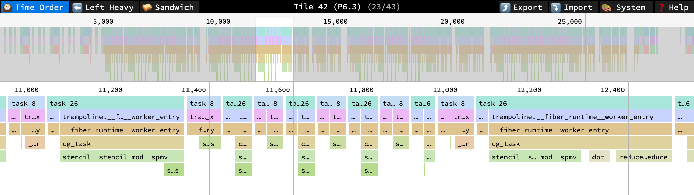

[simtracer](https://github.com/esa-tu-darmstadt/cerebras-simtracer) is a set of command-line tools that read the traces the Cerebras simulator writes and show what each PE did, cycle by cycle. It works on any CSL program. It is developed alongside csl++ and also reconstructs the call stacks of async functions across `suspend`, so a profile of a csl++ program shows its async functions as the frames they are in the source.

## Installation

simtracer is a Python package. Install it from its repository:

```bash
git clone https://github.com/esa-tu-darmstadt/cerebras-simtracer
pip install ./cerebras-simtracer
```

This installs the commands `simflame`, `simperfetto` and `simtrace`.

## Input

All commands take the output directory of a simulator run, `out/` in the SDK examples, which contains the ELF files in `bin/`. The simulator writes the instruction traces to `simfab_traces/`, which the commands look for inside the output directory, in the current directory and next to the output directory; `--trace-dir` names another location.

## Commands

| Command | Output |
| --- | --- |
| `simflame <out_dir> -o trace.speedscope.json` | A flamegraph of all PEs for [speedscope](https://www.speedscope.app). `--tiles 16,17` selects PEs. |
| `simperfetto <out_dir> -o trace.pftrace` | A trace for [Perfetto](https://ui.perfetto.dev) with one track per PE and channels for dispatch rate, wavelets and backpressure. `--cycles A:B` selects a range, `--all` enables every channel. |
| `simtrace <out_dir> <subcommand>` | Per-PE instruction traces in the terminal; see below. |

### simtrace

| Subcommand | Shows |
| --- | --- |
| `tiles` | The PEs that have trace events, with their ELF file and event count. |
| `funcs --tile N` | The functions in the ELF of a PE. |
| `show --tile N --cycles A:B` | The instructions a PE executed in a cycle range, with the task and function of each. `--regs` adds the operand values. |
| `find --tile N --func NAME` | The cycles at which a PE entered a function. |
| `stats --tile N` | How many cycles a PE spent per task, per function and per instruction. |
| `wavelets --tile N` | The wavelets a PE sent and received. |
| `which X,Y` | The ELF of a PE, without a trace. |

`--tile` takes the raw tile index or the coordinate `x.y`. With `--objdump <path to the llvm-objdump of the Cerebras SDK>`, `show` prints the disassembled instruction next to each address; the stock `llvm-objdump` cannot decode the instruction set.

## Async tasks in a trace

The hardware does not know about `suspend`. In the trace, an async task that suspends ends like any task, and its resumption is an activation of the task that enters the runtime's entry function and jumps into the middle of the suspended function. simtracer recognizes this jump from the instruction stream alone and keeps the frames of a suspended task until it resumes, so that:

- an async function appears as one frame from its call to its return, over every suspend in between, in `simflame` and `simperfetto`;
- the calls of `@await_parallel` that run on worker tasks appear under the lane of their worker task, next to the lane of the caller;
- `simtrace stats` and `show` attribute the instructions of a resumed function to that function, not to the runtime.

The runtime's own functions, which prepare a suspend and perform a resume, appear under their own names, prefixed with the name of the runtime.

## Example

The conjugate gradient solver of the [tutorial](../../tutorial/4-run/) runs on 25 PEs. After `./commands_wse3.sh`, the trace of the run is in `simfab_traces/` in the example directory, next to `out/`. Tiles are named by their fabric coordinates: the program was compiled with `--fabric-offsets=4,1`, so PE (2, 2) of the program is tile `6.3`.

```bash
simtrace out stats --tile 6.3 --top 5
```

```
Tile 42:  events=19,497  cycles 127..29815 (span 29689)

Tasks (top 5):
  task  26:     12,542  ( 64.3%)  terms=115
  task   8:      3,696  ( 19.0%)  terms=60
  task  29:      1,698  (  8.7%)  terms=31
  task   1:      1,263  (  6.5%)  terms=83
  task  21:        192  (  1.0%)  terms=8

Functions by dispatched instructions (top 5):
       3,611  ( 18.5%)  reduce__allreduce
       3,500  ( 18.0%)  __fiber_runtime__worker_entry
       3,364  ( 17.3%)  stencil__stencil_mod__spmv
       2,016  ( 10.3%)  stencil__stencil_mod__recv_from_neighbors
       2,004  ( 10.3%)  stencil__stencil_mod__send_to_neighbors
```

Task 26 is `cg_task`, which ran 115 times: once per activation after a `suspend`. Task 8 is the worker task on which `@await_parallel` in the stencil runs the receives. The functions of the libraries carry the names under which the modules are imported; the entry function of the async runtime is the code that runs at every resume.

```bash
simtrace out find --tile 6.3 --func spmv
```

```
     cycle  task  function  (uid)
      4635    26  stencil__stencil_mod__spmv  (uid=1947)
      9175    26  stencil__stencil_mod__spmv  (uid=5413)
     15290    26  stencil__stencil_mod__spmv  (uid=10030)
     21405    26  stencil__stencil_mod__spmv  (uid=14647)
```

The four entries are the four stencil products of the run: one for the initial residual and one per iteration. Each is a single entry although `spmv` suspends many times in between.

```bash
simflame out -o cg.speedscope.json
```

Open the file in [speedscope](https://www.speedscope.app). It has one profile per tile. The time-order view of PE (2, 2) during one iteration:



Every block of task 26 is one activation of the solver's task: it enters the runtime through its entry function and continues in `cg_task` and `spmv`, which were suspended, down to the send that resumed it. Between the blocks, task 8, the worker task of `@await_parallel`, runs the receives of the stencil. Later in the iteration, `dot` and `allreduce` follow `spmv` under `cg_task`.
