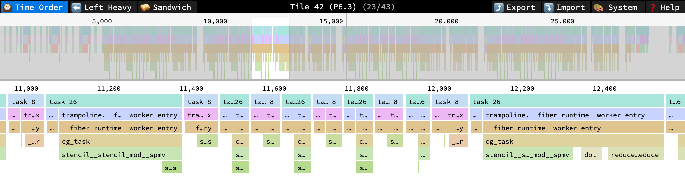

import Example from '../../../components/Example.astro';

The program is compiled and run from its directory in the repository, with `csl-pp` and the Cerebras SDK on the `PATH` as described in [Installation](../../start/installation/):

```bash
cd website/examples/tutorial/cg
./commands_wse3.sh
```

The script compiles for WSE-3 and runs the host program on the simulator:

<Example file="tutorial/cg/commands_wse3.sh" />

`csl-pp` takes the arguments of `cslc`. The one argument of its own is `--import-path`, which names the `csl-libs` directory of the repository so that `@import_module("allreduce/pe.csl")` is found. An installed `csl-pp` finds the libraries without it. `commands_wse2.sh` does the same for WSE-2.

## Compilation and run

`csl-pp` translates the layout file and the PE program, including the libraries, to vanilla CSL and calls `cslc` on the result. Programs with async tasks need two `cslc` runs, because `csl-pp` sizes the stack of each task from the stack frames `cslc` reports; see [csl-pp](../../tools/csl-pp/#stack-sizes). Then the host program writes the inputs, launches `solve`, and compares `x` with the same algorithm run on the host:

```
3 iterations, |r|^2 = 6.766016960144043 on the device, 6.766015529632568 on the host
SUCCESS!
```

The host program runs three iterations so that the simulator finishes in a few minutes; the residual is still far from the tolerance. `max_ite` in `run.py` sets the number.

To look at the generated CSL, add `--work-dir=<dir>` to the `csl-pp` command. The directory contains the layout file and one file per PE program, with the libraries included and the claims resolved to numbers.

## Looking at the trace

The simulator writes an instruction trace of every PE to `simfab_traces/` in the example directory. [simtracer](../../tools/simtracer/) turns it into a flamegraph in which the async functions appear as they are written, with `spmv` and `allreduce` nested under `cg_task` across all their suspends:

```bash
simflame out -o cg.speedscope.json
simtrace out stats --tile 6.3
```

Tile `6.3` is PE (2, 2) of the program; the tile coordinates include the fabric offset `4,1`.



Each block of task 26 is one activation of `cg_task` after a `suspend`; the stack under it is the one the source has. Task 8 is the worker task on which the stencil receives while task 26 sends.

## On hardware

`run.py` takes `--cmaddr IP:port` to run on a Cerebras system instead of the simulator, as the SDK examples do. The fabric dimensions in the command file are those of the simulator; see the SDK documentation for the dimensions of your system.

## Beyond the tutorial

- The benchmark version of this solver, with timing, is in `test/Integration/coro-benchmarks/conjugate-gradient` of the repository, next to ports of BiCGStab, the power method and GEMM and GEMV with the [`collectives_2d`](../../libraries/collectives_2d/) library.
- [Porting callback code](../../guides/porting/) describes how to turn a state machine into an async task step by step.
- [Writing a library](../../guides/libraries/) collects the rules for libraries with claims and async functions.
